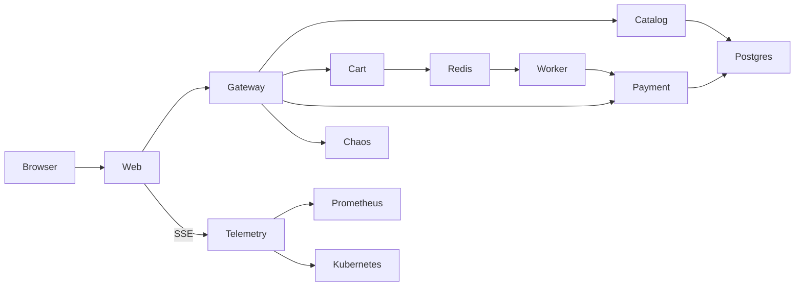

# Resilience Lab

A small shop running on a system you are allowed to break. Inject bounded faults, follow real requests and watch measured recovery.

**Public deployment: pending an Oracle Always Free account and approved resource plan.** No public URL or demo recording is invented. Read [STATUS.md](STATUS.md) for verified progress and remaining gates.

## What a reviewer should click

Add a keyboard → Kill payment → Checkout when the breaker opens → watch queued orders and recovery. After cooldown, Spike traffic → inspect actual replica changes. Open Engineering for the architecture, decisions, limitations and benchmark evidence. All payment processor behavior is explicitly simulated; infrastructure faults and recorded timings are real when connected.

## Run and verify

```sh
pnpm install --frozen-lockfile
make dev                 # generate ignored secrets and start Compose
make smoke               # products, cart, idempotent checkout, telemetry
make test                # lint, TypeScript, unit tests, frontend build
pnpm exec playwright install chromium
pnpm test:e2e
make k3d-up              # disposable local Kubernetes at localhost:8089
make bench               # >=10 real runs per fault; long and rate-limited
```

Compose UI: http://localhost:8088. Local preview: `pnpm dev`, http://localhost:5173. Windows setup uses the project's isolated ResilienceLab WSL distribution; run Docker/Make commands there. pnpm and source checks also work in PowerShell. Never commit `.env`, OCI keys, Terraform plans or state.



## Engineering

React 18, Vite, strict TypeScript, Fastify, zod contracts, Postgres 16, Redis 7/Streams, custom tested breaker/retry/bulkhead, OpenTelemetry, Prometheus, Jaeger, Docker, k3s/k3d, Kustomize, OCI Terraform and GitHub Actions. Application services run separately but share middleware and implementations in apps/runtime. See [architecture](docs/ARCHITECTURE.md), [ADRs](docs/adr), [deployment](docs/DEPLOY.md), [runbook](docs/RUNBOOK.md), [threat model](docs/THREAT_MODEL.md), [$0 budget](docs/COST.md) and [benchmark method](docs/benchmarks/REPORT.md).

Single-node recovery is not high availability. Compose does not autoscale. Missing metrics display unavailable. Cloud provisioning requires your review, and no paid fallback is automatic. The [demo script](docs/DEMO_SCRIPT.md) is ready; the owner still needs to record it. [Personal steps](docs/HUMAN_ACTIONS.md) are intentionally limited to account, credentials and approvals.
