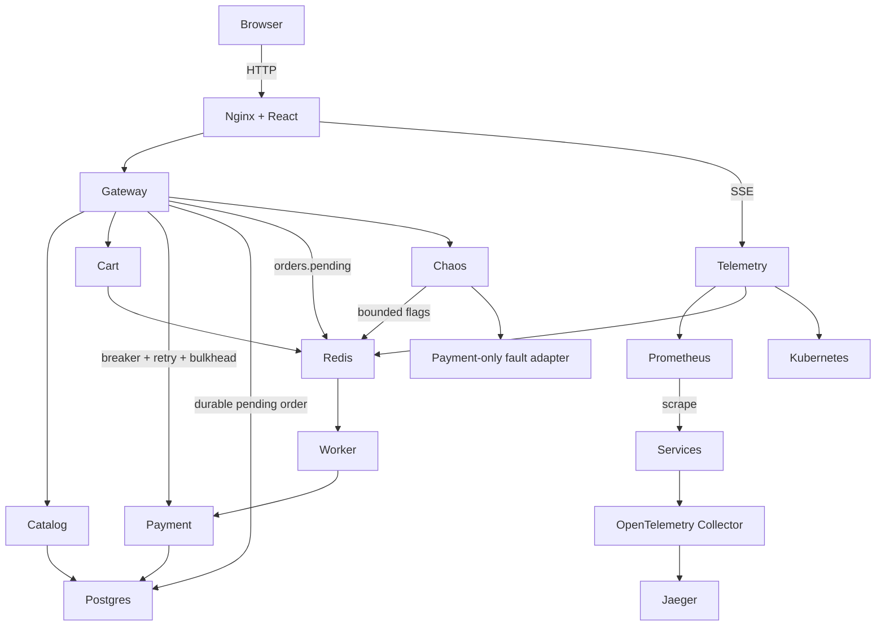

# Architecture

Each Fastify process is independently deployed; shared bootstrapping and service implementations live in apps/runtime to keep middleware and metric definitions consistent. SERVICE selects the process role. Services do not share memory. Postgres 16 owns products, orders, payments and recoveries. Redis 7 owns cart TTLs, bounded fault flags, streams, global fault slot and visitor quotas.

Gateway validates the cart, prices products from the catalog, persists an order and calls the processor with the order's idempotency key. Approved charges confirm the order; declines fail it. Transport failures queue it. Worker stream deliveries use the same idempotency key; completed orders are acknowledged. Reconciliation republishes stale processing/queued SQL orders after a publication or worker failure. This is at-least-once delivery, with idempotent payment effects, not an exactly-once system.

The rolling breaker is local to each gateway replica. Dashboard breaker_state uses the maximum of replicas (open dominates half-open and closed only after the explicit state aggregation is interpreted). Retry budgets include the first call plus at most two retries for reads, one for keyed payment calls. Each downstream has a 50-slot bulkhead.

Telemetry rates and percentiles come from Prometheus histograms. The request waterfall records actual checkout step intervals; OTel traces travel through the collector to Jaeger. They are distinct measurements and the waterfall is not fabricated from service latency distributions. No metrics are replaced with random values. The payment processor alone deliberately simulates external processor behavior.

Kubernetes isolates payment in lab-payment because RBAC cannot restrict pod deletes using a label selector. A narrow proxy lists payment-labelled pods and deletes only those; its service account has no permissions in lab. The chaos controller itself has no Kubernetes delete credentials. Other workloads are in lab, with default-deny network policies and explicit flows.
